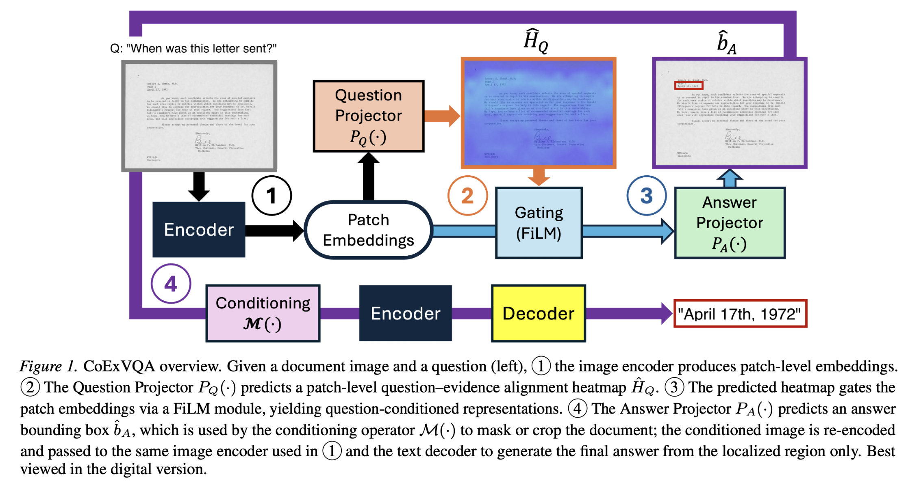

<div align="center">
    <h1>GroundLens</h1>
    <i>Official implementation of "Towards Self-Explainable Document Visual Question Answering with Chain-of-Explanation Predictions"</i>
    <br>
</div>

<br>

---



Ground lens requires vision–language models to reason not only about what information in a document is relevant to a question, but also where the answer is grounded on the page. Despite strong predictive performance, existing DocVQA systems entangle these two aspects and operate largely as black boxes, offering limited means to verify how predictions depend on visual evidence. We propose **GroundLens**, a self-explainable DocVQA framework that enforces a grounded reasoning process through a chain-of-explanation design. The model first identifies question-relevant evidence, then explicitly localizes the answer region, and finally decodes the answer exclusively from the grounded region. By making both evidence selection and spatial grounding intrinsic to prediction, GroundLens enables direct inspection and verification of the reasoning process across modalities. Empirical results show that restricting decoding to grounded evidence yields competitive performance while providing transparent and verifiable predictions.

## Dataset

This project uses an augmented version of the [DocVQA dataset](https://www.docvqa.org/) with additional annotations for question priors and answer locations. See [Dataset Setup](docs/dataset_setup.md) for more details.

## Installation

For detailed setup instructions, see [Environment Setup](docs/environment_setup.md).

Quick start with conda:

```bash
conda env create -f environment.yml
conda activate groundlens
```

## Project Structure

```
.
├── src/
│   ├── datasets/          # Dataset loaders and preprocessing
│   ├── evaluation/        # Evaluation metrics and utilities
│   ├── model/             # Model architectures and components
│   ├── pipelines/         # Prior generation
│   ├── priors/            # Prior handling
│   ├── scripts/
│   │   ├── training/      # Training scripts
│   │   ├── evaluation/    # Evaluation scripts
│   │   └── generation/    # Generation scripts
│   └── utils/             # Utility functions and helpers
├── tests/                 # Test suite
├── slurm_scripts/         # SLURM job submission scripts
├── assets/                # Static assets
├── requirements.txt       # Python dependencies (pip)
└── environment.yml        # Conda environment specification
```

**Note:** The repository includes experimental code and alternative implementations. The key files for the main model are the training script at [src/scripts/training/train.py](src/scripts/training/train.py) and the evaluation script at [src/scripts/evaluation/eval.py](src/scripts/evaluation/eval.py).

## License

This project is licensed under the [License](LICENSE).
If you found the work useful, please give proper citation for both the original dataset used and our work.

This work uses the DocVQA dataset:

```bibtex
@misc{mathew2021docvqadatasetvqadocument,
    title={DocVQA: A Dataset for VQA on Document Images},
    author={Minesh Mathew and Dimosthenis Karatzas and C. V. Jawahar},
    year={2021},
    eprint={2007.00398},
    archivePrefix={arXiv},
    primaryClass={cs.CV},
    url={https://arxiv.org/abs/2007.00398},
}
```
